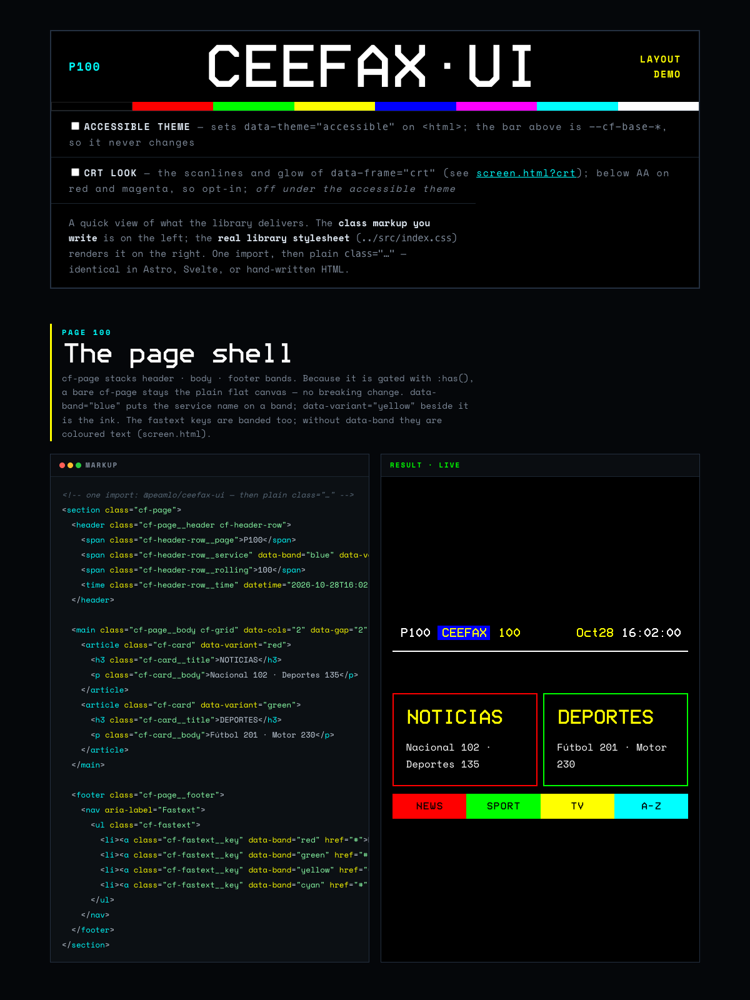
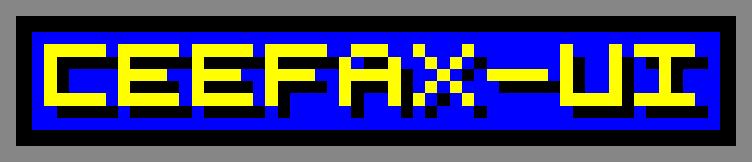

# ceefax-ui

A Ceefax / teletext-inspired, **framework-agnostic, CSS-first** design system. Ships design tokens + semantic CSS classes + self-hosted fonts. **No JS component runtime** — consume it as plain `class="…"` in Astro, Svelte, or plain HTML. The one interactive widget (`<cf-loader>`) is a standard Web Component.

## Install

Published on npm as [`@peamlo/ceefax-ui`](https://www.npmjs.com/package/@peamlo/ceefax-ui).

```sh
npm install @peamlo/ceefax-ui
```

## Use

Import the stylesheet once (in your Astro layout, Svelte root, or `<head>`), then write semantic classes:

```astro
---
import "@peamlo/ceefax-ui";           // all styles
import "@peamlo/ceefax-ui/elements";  // optional — registers <cf-loader> + <cf-canvas>
---
<a class="cf-link" href="/about" aria-current={pathname === "/about" ? "page" : undefined}>ABOUT</a>
```

Svelte and plain HTML are identical — there is no framework binding.

## Demo

A one-page showcase of what the library delivers — the layout primitives and
components in a teletext blog, with the markup you write beside the live result.
**Live:** [demo](https://peamlo.github.io/ceefax-ui/demo/) · [Storybook](https://peamlo.github.io/ceefax-ui/). Or run it locally:

```sh
npm run demo   # serves the repo, then open http://localhost:3000/demo/
```

It's a plain static page ([`demo/index.html`](demo/index.html)) that consumes the
real `src/index.css` and the self-hosted fonts — the result panels are the library,
not a mockup.



## The contract (do not drift from this)

**One semantic class on the correct native element. State from native/ARIA attributes. `data-*` only for presentational variants.**

```html
<!-- identity = class · look-only variant = data-* · state = native/ARIA attrs -->
<button class="cf-btn">Read more</button>
<button class="cf-btn" data-variant="red">▸ RED · INDEX</button>
<button class="cf-btn" data-size="lg" disabled>Off air</button>

<a class="cf-link" href="/posts">POSTS</a>
<a class="cf-link" href="/about" aria-current="page">ABOUT</a>   <!-- persistent ▸ caret -->
```

- **Never** write state-modifier classes (`cf-btn--disabled`, `cf-btn--active`). Use the real `disabled` attribute, `:focus-visible`, `[aria-current]`, `[aria-pressed]`.
- **`data-variant`** is only for a presentational colour — any of the six named authentic colours (`red`/`green`/`yellow`/`blue`/`cyan`/`magenta`), plus the look-only `ghost` on a button and `nav` on a link. Each component decides how it paints that colour: the button fills, the card borders, the fastext key backgrounds. An unrecognised name renders the component's default, unstyled look. A **fastext bar** is still the four teletext keys (`red`/`green`/`yellow`/`blue`) — that is the domain, not a styling limit.
- No utility classes, no compound-class soup.

### States

- **Focus** (`:focus-visible`) → instant colour **inversion**. Transient; "the keyboard is here."
- **Selected** (`[aria-current="page"]`) → persistent **▸ caret**. "You are on this page."
- **Hover** → same inversion as focus (intentional).
- **Active** → instant `scale(.96)`, no colour ramp.

## Components

| Class | Element | Variants (`data-*`) | State |
|---|---|---|---|
| `cf-btn` | `<button>` / `<a>` | `variant` red/green/yellow/blue/ghost · `size` sm/md/lg | `:disabled`, `:focus-visible`, `:active` |
| `cf-link` | `<a>` | `variant="nav"` | `[aria-current="page"]` |
| `cf-card` | any block | `variant` red/green/yellow/blue/cyan/magenta | — |
| `cf-fastext` / `cf-fastext__key` | `<ul>` / `<a>` | `variant` red/green/yellow/blue | `:focus-visible` |
| `cf-notice` / `cf-notice__flag` | block + `role="note"` / `<strong>` | `variant` red (default, danger)/yellow (warning)/green (success)/blue/cyan/magenta · `blink="off"` | flash (reduced-motion aware) |
| `cf-page` + `data-frame` | `<section>` with `header`/`main`/`footer` | `frame` (4:3 screen; `--cf-frame-ratio` to change) | — |
| `<cf-loader>` | Web Component | — | blink (reduced-motion aware) |
| `<cf-canvas>` | Web Component | `size` sm/md/lg/full | `alt` → `role="img"` |

### Notice (`cf-notice`)

For something the reader mustn't miss: a thick border and a short capitalised flag that flashes like teletext flash text, once a second for about 5 seconds, then holds solid. Danger (red) is the default; `data-variant="yellow"` is a warning and `data-variant="green"` a success (usually with `data-blink="off"`: good news rarely needs a flash). The other variant colours work too. The body is free content.

```html
<div class="cf-notice" role="note">
  <strong class="cf-notice__flag">Mismatch</strong>
  <p>Mismatch: the plan says €75,000 but the contract says €70,000.</p>
</div>
```

- **`role="note"`, not `role="alert"`:** a static notice shouldn't interrupt a screen reader on page load.
- **Repeat the flag in the body.** The flag is one terse word; the body must carry its meaning too, so neither the colour nor the flash is the only cue.
- **One flashing notice per screen.** Put `data-blink="off"` on the others. The flash is always off under `prefers-reduced-motion: reduce`.

### Pixel canvas (`<cf-canvas>`)

A render-only [custom element](./CONTEXT.md) that draws teletext-style **pixel art** on a `<canvas>` — headers, logos, scenes. Import it from the opt-in `./elements` export. The artwork is the element's **text content**: newline-separated rows of single-char palette codes.

```html
<script type="module">import "@peamlo/ceefax-ui/elements/cf-canvas";</script>

<cf-canvas alt="CEEFAX holidays — palm tree" data-size="md">
bbbbggbbbbggbbbbbbbb
bbggggggggggggbbbbbb
bbbgggggrgggggbbbbbb
bbbbbbbrbbbbbbbbbbbb
yyyyyyyyyyyyyyyyyyyy
</cf-canvas>
```

- **Palette codes:** `k` black · `r` red · `g` green · `y` yellow · `b` blue · `m` magenta · `c` cyan · `w` white · `.` (or space) transparent. Colours are the authentic values by default and follow the [accessible theme](#accessible-theme) like `data-variant` blocks (black and white never change); unknown codes render transparent (with a dev-console warning). Free per-pixel colour — no one-colour-per-cell limit.
- **Grid** dimensions are inferred from the text (ragged rows pad with transparent; common leading indentation is stripped — use `.` for intentional left-edge transparent pixels).
- **Sizing** is fluid and crisp (`image-rendering: pixelated`), capped at `--cf-content-max`. Pick a tier with `data-size` (`sm`/`md`/`lg`/`full`) or set an exact scale with the `--cf-pixels-scale` escape hatch (`style="--cf-pixels-scale: 8"` = 8 CSS px per pixel).
- **Accessibility:** provide `alt` for a meaningful image (→ `role="img"` + `aria-label`); omit it to mark the canvas decorative (`aria-hidden`).
- **Live edits** re-render automatically (the future paint-it-yourself editor builds on this).



See [ADR-0004](./docs/adr/0004-cf-canvas-pixel-art.md) for the reasoning.

## Tokens

Colour tokens come in two tiers, both under the `cf` namespace:

- **`--cf-base-*`** — the authentic 8 broadcast colours (`--cf-base-red`, …). Fixed and **never** remapped, so a theme cannot change them.
- **Semantic aliases** — every other `--cf-*` colour (`--cf-bg`, `--cf-fg`, `--cf-link`, `--cf-danger`, …). They say what a colour is *for*, and they are what themes remap.

Use the semantic aliases in your own CSS so it follows the active theme; reach for `--cf-base-*` only when you deliberately want the authentic colour whatever the theme (e.g. pixel art). The library's own component and layout stylesheets, and the variant seam, use semantic aliases only — CI enforces it.

Spacing is `ch`-based; radius is always `0`.

## Accessible theme

The authentic palette is the point of the library, but it is not accessible: authentic blue is 2.44:1 on black, and `danger = red` / `success = green` is the classic red–green confusion. Opt into the **accessible theme** with one attribute — no JavaScript, no build step, no markup changes:

```html
<html data-theme="accessible">
```

It also works on any subtree (`<section data-theme="accessible">`) to scope it to one region. Without the attribute nothing changes.

The theme is colour-vision-deficiency optimised (Okabe–Ito-inspired): every colour clears **WCAG AAA (≥ 7:1)** on black, and `danger`/`success` sit on the blue–yellow axis (amber vs teal) so they stay apart under red–green colour-blindness. Your existing `data-variant` markup is re-coloured through the same names:

| `data-variant` / alias | Accessible colour | On black |
|---|---|---|
| `red` · `--cf-danger` | amber `#FF9E4D` | 10.3:1 |
| `green` · `--cf-success`, `--cf-accent-2` | teal `#33E0C0` | 12.6:1 |
| `yellow` · `--cf-accent`, `--cf-warning`, `--cf-link-hover` | yellow `#FFFF00` | 19.6:1 |
| `blue` | sky `#66B3FF` | 9.5:1 |
| `magenta` · `--cf-link-visited` | orchid `#E0A0D0` | 10.1:1 |
| `cyan` · `--cf-link`, `--cf-info` | ice `#99E6FF` | 15.1:1 |
| `--cf-fg-dim` | grey `#B3B3B3` | 10.0:1 |

Every block colour is light, so the ink on a variant block is black — blue included. The theme only remaps semantic aliases (including the `--cf-variant-*` tier the variant colours resolve through); `--cf-base-*` keeps the authentic colours. Pixel art (`<cf-canvas>`) follows the theme too, repainting when the attribute changes; art that pairs two colours (yellow on blue) loses some contrast between them, so give meaningful art an `alt`. Colour is still never the only cue: fastext keys keep their labels and the current page its caret. Try it in Storybook (toolbar → Theme) or on the demo page's switch.

## Develop

```sh
npm install
npm run storybook      # framework-agnostic Storybook (HTML mode) — play with every variant
npm run build          # PostCSS → dist/index.css + dist/tokens.css
```

Storybook uses `@storybook/html-vite` + the a11y addon, with interactions built in, so stories show the exact HTML contract, run live WCAG checks, and can script keyboard/focus behaviour.

## Fonts

Both self-hosted. [Bedstead](https://bjh21.me.uk/bedstead/), a recreation of the SAA5050 teletext character set (public domain), is the display face: headings, card titles and fastext keys. Space Mono (SIL OFL 1.1) is the body face. Sources, versions and licences: [`fonts/README.md`](./fonts/README.md).

## License

MIT (code) · Bedstead public domain, Space Mono SIL OFL 1.1 (bundled fonts).
