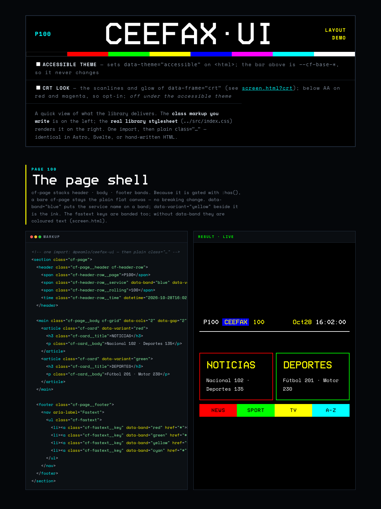

# ceefax-ui

A Ceefax / teletext-inspired, **framework-agnostic, CSS-first** design system. Ships design tokens + semantic CSS classes + self-hosted fonts. **No JS component runtime** — consume it as plain `class="…"` in Astro, Svelte, or plain HTML. The one interactive widget (`<cf-loader>`) is a standard Web Component.

## Install

Published on npm as [`@peamlo/ceefax-ui`](https://www.npmjs.com/package/@peamlo/ceefax-ui).

```sh
npm install @peamlo/ceefax-ui
```

## Use

Import the stylesheet once (in your Astro layout, Svelte root, or `<head>`), then write semantic classes:

```astro
---
import "@peamlo/ceefax-ui";           // all styles
import "@peamlo/ceefax-ui/elements";  // optional — registers <cf-loader>
---
<a class="cf-link" href="/about" aria-current={pathname === "/about" ? "page" : undefined}>ABOUT</a>
```

Svelte and plain HTML are identical — there is no framework binding.

## Demo

A one-page showcase of what the library delivers — the layout primitives and
components in a teletext blog, with the markup you write beside the live result.
**Live:** [demo](https://peamlo.github.io/ceefax-ui/demo/) · [Storybook](https://peamlo.github.io/ceefax-ui/). Or run it locally:

```sh
npm run demo   # serves the repo, then open http://localhost:3000/demo/
```

It's a plain static page ([`demo/index.html`](demo/index.html)) that consumes the
real `src/index.css` and the self-hosted fonts — the result panels are the library,
not a mockup. [`demo/form.html`](demo/form.html) puts every form control in one
real form, a holiday enquiry.



## The contract (do not drift from this)

**One semantic class on the correct native element. State from native/ARIA attributes. `data-*` only for presentational variants.**

```html
<!-- identity = class · look-only variant = data-* · state = native/ARIA attrs -->
<button class="cf-btn" type="button">Read more</button>
<button class="cf-btn" type="button" data-variant="red">▸ RED · INDEX</button>
<button class="cf-btn" type="button" data-size="lg" disabled>Off air</button>

<a class="cf-link" href="/posts">POSTS</a>
<a class="cf-link" href="/about" aria-current="page">ABOUT</a>
<!-- persistent ▸ caret -->
```

- **Never** write state-modifier classes (`cf-btn--disabled`, `cf-btn--active`). Use the real `disabled` attribute, `:focus-visible`, `[aria-current]`, `[aria-pressed]`.
- **`data-variant`** is only for a presentational colour — any of the six named authentic colours (`red`/`green`/`yellow`/`blue`/`cyan`/`magenta`), plus the look-only `ghost` on a button, `nav` on a link and `character` on a checkbox or radio. Each component decides how it paints that colour: the button fills, the card borders, the fastext key colours its label. An unrecognised name renders the component's default, unstyled look. A **fastext bar** has one to four keys, shown as red / green / yellow / cyan on screen. Any seam colour works, but blue text on the black page fails contrast.
- **`data-band`** sets a coloured **band** behind a text part, one of the same six colours. On a banded part `data-variant` names the ink; without it the band gets the readable default ink (black, white on blue). Only parts whose `data-variant` is a text colour take a band (the header row's parts, the table's, fastext keys and mosaics); blocks such as buttons never do. An unknown name renders no band. See [Bands](#bands).
- No utility classes, no compound-class soup.
- **Interactive widgets** follow an [APG pattern](https://www.w3.org/WAI/ARIA/apg/patterns/), and their state comes from that pattern's native or ARIA attributes ([ADR-0022](./docs/adr/0022-interactive-widgets-are-native-elements.md)).

### States

- **Focus** (`:focus-visible`) → instant colour **inversion** on controls you activate (buttons, links, fastext keys); a thin accent **focus ring** on controls you stay in (text fields, checkboxes, radios, selects, scroll regions). Transient; "the keyboard is here." ([ADR-0024](./docs/adr/0024-focus-inversion-to-activate-ring-to-stay-in.md))
- **Selected** (`[aria-current="page"]`) → persistent **▸ caret**. "You are on this page."
- **Hover** → same inversion as focus (intentional).
- **Active** → instant `scale(.96)`, no colour ramp.

### Accessibility

The library targets WCAG 2.2 AA (AAA contrast under the [Accessible theme](#accessible-theme)) and follows [APG patterns](https://www.w3.org/WAI/ARIA/apg/patterns/), but conformance belongs to your site, not to the library: it depends on the content and markup you put in the components.

## Components

| Class                                                                                     | Element                                                                    | Variants (`data-*`)                                                                                                                                                                                        | State                                                                                                            |
| ----------------------------------------------------------------------------------------- | -------------------------------------------------------------------------- | ---------------------------------------------------------------------------------------------------------------------------------------------------------------------------------------------------------- | ---------------------------------------------------------------------------------------------------------------- |
| `cf-btn`                                                                                  | `<button>` / `<a>`                                                         | `variant` red/green/yellow/blue/ghost · `size` sm/md/lg (`sm` is still a 24px target)                                                                                                                      | `:disabled`, `:focus-visible`, `:active`                                                                         |
| `cf-link`                                                                                 | `<a>`                                                                      | `variant="nav"`                                                                                                                                                                                            | `[aria-current="page"]`                                                                                          |
| `cf-card`                                                                                 | any block                                                                  | `variant` red/green/yellow/blue/cyan/magenta                                                                                                                                                               | —                                                                                                                |
| `cf-fastext` / `cf-fastext__key`                                                          | `<ul>` / `<a>`                                                             | `variant` (text colour) · `band` (filled key, ADR-0017); 1–4 keys in equal columns                                                                                                                         | `:focus-visible`                                                                                                 |
| `cf-notice` / `cf-notice__flag`                                                           | block + `role="note"` / `<strong>`                                         | `variant` red (default, danger)/yellow (warning)/green (success)/blue/cyan/magenta · `blink="off"`                                                                                                         | flash (reduced-motion aware)                                                                                     |
| `cf-popover`                                                                              | element with `popover`                                                     | `variant` (border colour)                                                                                                                                                                                  | `:popover-open`, Esc, light dismiss                                                                              |
| `cf-stat` / `cf-stat__value` / `cf-stat__label`                                           | `<p>` or `<div>` / `<span>` / `<span>`                                     | `variant` (text colour, accent by default) · `band` (background; `variant` is then the ink)                                                                                                                | —                                                                                                                |
| `cf-reveal` / `cf-reveal__index`                                                          | `<details>` / `<span>` in `<summary>`                                      | `variant` (number colour)                                                                                                                                                                                  | `[open]`, `:focus-visible`, `name` (accordion)                                                                   |
| `cf-header-row` / `cf-header-row__page` / `__service` / `__rolling` / `__time` / `__date` | `<header>` / `<span>` ×3 / `<time datetime>` / `<span>` in the `<time>`    | `variant` on any part (text colour) · `band` on any part (background; `variant` is then the ink)                                                                                                           | —                                                                                                                |
| `cf-table` / `cf-table__scroll`                                                           | `<table>` / `<section>`                                                    | `stripe-rows` / `stripe-cols` text/band · `variant` / `band` on any part · `align="end"` / `leader` on a cell · `side="bottom"` on the caption                                                             | `[aria-current="true"]` on a row · `:focus-visible` on the scroll region                                         |
| `cf-field` / `cf-field__hint` / `cf-field__error`                                         | block with `<label>` + control / `<p>` / `<p>`                             | —                                                                                                                                                                                                          | —                                                                                                                |
| `cf-input` / `cf-textarea` / `cf-select`                                                  | text-like `<input>` / `<textarea>` / single `<select>`                     | — (`size`, `cols`, `rows` set the size)                                                                                                                                                                    | `:focus-visible`, `:user-invalid`, `[aria-invalid="true"]`, `:disabled`                                          |
| `cf-checkbox` / `cf-radio`                                                                | `<input type="checkbox">` / `<input type="radio">` in a wrapping `<label>` | `variant="character"`                                                                                                                                                                                      | `:checked`, `:indeterminate` (checkbox), `:focus-visible`, `:user-invalid`, `[aria-invalid="true"]`, `:disabled` |
| `cf-dialog`                                                                               | `<dialog>`                                                                 | `variant` (border colour) · `size` sm/lg                                                                                                                                                                   | `[open]`, `:modal`, Esc, backdrop click (`closedby="any"`)                                                       |
| `<cf-loader>`                                                                             | Web Component                                                              | —                                                                                                                                                                                                          | blink (reduced-motion aware)                                                                                     |
| `cf-mosaic`                                                                               | `<span>`                                                                   | `variant` (ink) · `band` (background) on the mosaic or a span inside it · `mosaic="separated"`                                                                                                             | `aria-hidden` (decorative) or `role="img"` + `aria-label`                                                        |
| `cf-page` + `data-frame`                                                                  | `<section>` with `header`/`main`/`footer`                                  | `frame` (4:3 screen; `--cf-frame-ratio` to change) · `cells` 40/60/80 (`--cf-frame-cells` for any count) · `crt` adds scanlines + glow (opt-in, below AA on red/magenta) · `scrollbar` fastext/mosaic/thin | —                                                                                                                |

### Notice (`cf-notice`)

For something the reader mustn't miss: a thick border and a short capitalised flag that flashes like teletext flash text, once a second for about 5 seconds, then holds solid. Danger (red) is the default; `data-variant="yellow"` is a warning and `data-variant="green"` a success (usually with `data-blink="off"`: good news rarely needs a flash). The other variant colours work too. The body is free content.

```html
<div class="cf-notice" role="note">
  <strong class="cf-notice__flag">Mismatch</strong>
  <p>Mismatch: the plan says €75,000 but the contract says €70,000.</p>
</div>
```

- **`role="note"`, not `role="alert"`:** a static notice shouldn't interrupt a screen reader on page load.
- **Repeat the flag in the body.** The flag is one terse word; the body must carry its meaning too, so neither the colour nor the flash is the only cue.
- **One flashing notice per screen.** Put `data-blink="off"` on the others. The flash is always off under `prefers-reduced-motion: reduce`.

### Popover (`cf-popover`)

Follows the APG [Disclosure](https://www.w3.org/WAI/ARIA/apg/patterns/disclosure/) pattern. A small floating panel tied to a button: a short explanation next to an "Info" button, a few pages under a "Pages ▾" button. It is the native `popover` attribute, opened by an invoker command on the button, so the browser does the rest with no JavaScript ([ADR-0022](docs/adr/0022-interactive-widgets-are-native-elements.md)): it opens in the top layer, closes on a click outside or Esc, and opening one closes any other. It is painted like a [card](#components): a thin border, the page background, `--cf-space-3` padding, fitting its content up to one 40-cell row and never wider than the screen. `data-variant` colours the border; carry the meaning in the text and the button's label, never the colour alone.

```html
<button class="cf-btn" type="button" command="toggle-popover" commandfor="pages">
  Pages <span aria-hidden="true">▾</span>
</button>
<div popover class="cf-popover" id="pages">
  <ul>
    <li><a class="cf-link" href="/101">News 101</a></li>
    <li><a class="cf-link" href="/300">Sport 300</a></li>
    <li><a class="cf-link" href="/400">Weather 400</a></li>
  </ul>
</div>
```

- **A dropdown is a popover holding a `<ul>` of `cf-link`s** (or ghost `cf-btn`s), not a component of its own. It is APG's [disclosure navigation menu](https://www.w3.org/WAI/ARIA/apg/patterns/disclosure/examples/disclosure-navigation/), not an ARIA `role="menu"`: Tab walks the items right after the trigger, and there are no arrow keys. The list's bullets and indent are removed; the links keep their own inversion.
- **Anchored to its trigger** where the browser supports CSS anchor positioning: below the button at its start edge, one thin border off it, and flipped above or to the other side where there's no room. The button that opened it is its anchor, so you write no `anchor-name`. Move it with `--cf-popover-area`, which takes any `position-area` value: `block-start span-inline-end` opens it above, `inline-end span-block-end` to the end. The thin-border gap is above and below only, so the popover lines up with the trigger's start edge; beside the trigger, add `margin-inline: var(--cf-border-thin)` for the same gap.
- **Write the ▾ in the trigger's label.** The browser tells assistive technology whether the popover is expanded, but it writes no `aria-expanded` into the page, so the library has no open style for the trigger.
- **Browser support:** invoker commands (`command` / `commandfor`) are in Chromium, Firefox and Safari since 2025; add a polyfill for older browsers. Anchor positioning is newer: without it the browser centres the popover on the screen, which still works.
- **With a headless library** (Radix, Melt/Bits, Reka, Zag) driving its own element, `cf-popover` paints the look only and leaves the position to the library. Put the library's portal container inside `.cf-page` (or the theme on `<html>`), or the portalled panel loses the Screen frame and the theme. A native popover needs none of this: the top layer only changes where it's drawn, and it still inherits from its place in the page.

### Stat (`cf-stat`)

A headline figure, read before the text around it: the value in the display typeface at teletext double height, twice the label, in the accent colour, then the label that says what it means. `data-variant` picks another colour from the same six names the card and button take; `data-band` sets a [band](#bands) behind the whole stat, and `data-variant` is then the ink of both parts. The label is required, so the colour is never the only cue. Write the figure already formatted; the stat doesn't format numbers.

```html
<div class="cf-grid" data-cols="3">
  <p class="cf-stat"><span class="cf-stat__value">€75,000</span> <span class="cf-stat__label">to allocate</span></p>
  <p class="cf-stat" data-variant="green">
    <span class="cf-stat__value">€90,000</span> <span class="cf-stat__label">deposit and costs</span>
  </p>
  <p class="cf-stat" data-variant="cyan">
    <span class="cf-stat__value">≈23 months</span> <span class="cf-stat__label">to get there</span>
  </p>
</div>
```

- **Value first, then the label,** in one neutral block, so a screen reader hears "€75,000 to allocate". It isn't a heading; if the stat really is the section title, wrap it in one.
- **No more than three equally weighted stats per screen.** Lay them out with `cf-grid` or `cf-cluster`; for a long list of figures, use a [table](#table-cf-table).
- **In the Screen frame** the value is two cells high and the label one, and the label is the frame's authentic green.
- **A long figure wraps** in its column rather than scrolling the page. Authentic blue text is hard to read on black (about 2.4:1); the Accessible theme lifts it.

### Reveal (`cf-reveal`)

Follows the APG [Disclosure](https://www.w3.org/WAI/ARIA/apg/patterns/disclosure/) pattern, on the native `<details>`: content the reader opens only if they care, such as a FAQ, questions to prepare for a meeting, an exercise's solution, a glossary or "show details". It's named after the REVEAL button on a teletext remote. One class on the `<details>`; the `<summary>` is a full-width row with a ▼ when closed and a ▲ when open, and anything after it is revealed in place, indented under the summary text. No JavaScript: the browser toggles it on click, Enter and Space, and announces whether it's expanded. Add `open` to render it expanded.

```html
<details class="cf-reveal">
  <summary>Show the fees</summary>
  <p>0.12% a year, charged monthly. No fee to join or leave.</p>
</details>
```

Reveals in a row stack into a **list**, sharing one rule between neighbours, with no wrapper. Several can be open at once. Give them the same `name` and they become an **accordion**: the HTML standard's exclusive `<details>` group, where opening one closes the others. That attribute is the only difference.

```html
<details class="cf-reveal" name="glossary" open>
  <summary>TAE</summary>
  <p>The annual rate you earn once compounding is counted.</p>
</details>
<details class="cf-reveal" name="glossary">
  <summary>Money-market fund</summary>
  <p>A fund that lends for days or weeks, so its price barely moves.</p>
</details>
```

Group a list with a heading per group, here "your questions" and "suggested", with a number variant each:

```html
<h3>Your questions</h3>
<details class="cf-reveal" data-variant="green">
  <summary><span class="cf-reveal__index">1</span>What does TAE mean?</summary>
  <p>The annual rate you earn once compounding is counted.</p>
</details>
<details class="cf-reveal" data-variant="green">
  <summary><span class="cf-reveal__index">2</span>Can I take the money out early?</summary>
  <p>From the account, any day. From the fund, in one to three working days.</p>
</details>

<h3>Suggested questions</h3>
<details class="cf-reveal" data-variant="yellow">
  <summary><span class="cf-reveal__index">3</span>What happens if the bank fails?</summary>
  <p>Deposits are covered up to €100,000 per person and bank.</p>
</details>
```

- **`cf-reveal__index` is optional:** a number so a FAQ can say "question 3". `data-variant` colours it (accent by default); without a number the variant has no effect.
- **Label groups in text,** with a heading each as above, so colour isn't the only grouping cue.
- **Reveal items aren't headings.** A `<summary>` isn't one, and a heading inside it is announced inconsistently, so screen-reader users can't jump item to item. Split a long FAQ into headed groups instead of nesting headings in `<summary>`.
- **Don't hide critical information in a reveal.** Readers skim past closed items; anything they must see belongs on the page.
- **Use the native element.** The stylesheet doesn't style a headless library's `button[aria-expanded]` plus panel: `<details name>` works in every engine, so a library adds nothing here (ADR-0022).
- **Instant,** like teletext: no open or close animation.

### Header row (`cf-header-row`)

The single top line of a teletext page, in broadcast colours: the page you asked for, the service name, the page on air, then the date and time. It is the **only** place the page number appears; screen titles stay ordinary headings. In the page shell, put both classes on the same `<header>`, no wrapper.

```html
<header class="cf-page__header cf-header-row">
  <span class="cf-header-row__page">P455</span>
  <span class="cf-header-row__service">CEEFAX</span>
  <span class="cf-header-row__rolling">454</span>
  <time class="cf-header-row__time" datetime="2026-10-28T15:23:19"
    ><span class="cf-header-row__date">Oct28</span> 15:23:19</time
  >
</header>
```

- **The page number is real text,** never `aria-hidden` or colour alone, so a screen reader announces "P455".
- **`__rolling` is the rolling page number,** the page on air. On a real set it rolls while the set searches for the page you asked for; here it's static, so it usually matches `__page` without the `P`.
- **Colour any part** with `data-variant`, as on every component: it sets that part's text colour (`<span class="cf-header-row__date" data-variant="magenta">Oct28</span>`). Authentic blue text is hard to read on black (about 2.4:1); the Accessible theme lifts it.
- **Band any part** with `data-band` (see [Bands](#bands)): `<span class="cf-header-row__service" data-band="blue" data-variant="yellow">Teletext</span>` is a broadcast-style yellow-on-blue service name. Without `data-variant` the band takes its readable default ink.
- **The time is static.** Write the `<time datetime>` yourself (when the page was published, not "now"): `datetime` is the machine-readable ISO value, the text is what readers see, as `Oct28 15:23:19`. There is no JavaScript and no ticking clock.
- **Narrow viewports** wrap the time onto a second line; the page number stays first.

### Scrollbars

Every scroll container inside the page shell (`.cf-page` and everything in it) gets a teletext scrollbar, with no CSS of your own. Nothing outside `.cf-page` is touched; for the whole document, put `cf-page` on `<body>`. Pick a look with `data-scrollbar`:

| `data-scrollbar`      | Look                                                                        |
| --------------------- | --------------------------------------------------------------------------- |
| _(none)_, the default | **block**: a square foreground thumb on the background, with a border rule  |
| `fastext`             | a yellow thumb on a deep-blue track, with cyan ▲▼ step buttons              |
| `mosaic`              | a checkered cyan thumb on a black track striped with the dim foreground     |
| `thin`                | a narrow bar (two thirds of block), foreground on background, for dense UIs |

```html
<section class="cf-page" data-scrollbar="fastext">
  …
  <pre data-scrollbar="thin">…</pre>
</section>
```

- **It inherits,** so the nearest `data-scrollbar` wins: set it once on `.cf-page`, override it on one scroller. An unknown value keeps the inherited look.
- **Hover or drag inverts the thumb** (and fastext's buttons), like every other Inversion.
- **Colours are the semantic aliases,** so the Accessible theme, or an alias you override, recolours the bar. Put the theme or the override on `.cf-page` or on the element that carries `data-scrollbar` (`<pre data-scrollbar="thin" style="--cf-accent: …">`): that is where the bar's colours are resolved. Sizes are in `em`, so the bar scales with the Screen frame.
- **Firefox only takes two colours and a width:** it shows the variant's thumb and track colours, with no square shape, pattern, buttons or hover. Chrome and Safari show the full look; fastext's step buttons are on vertical bars only.

### Table (`cf-table`)

A native table set like a broadcast league table: one line per row, figures to the end, and no rule under every row. Group rows with native `<tbody>` elements; the only rule is the **group rule** between groups (and before `<tfoot>`). Wrap the table in its own scroll region, named from the caption, so a wide table scrolls by itself and never the page.

```html
<section class="cf-table__scroll" tabindex="0" aria-labelledby="t1">
  <table class="cf-table">
    <caption id="t1">
      Premier League · final table
    </caption>
    <thead>
      <tr>
        <th scope="col">Pos</th>
        <th scope="col">Team</th>
        <th scope="col" data-align="end">Pts</th>
      </tr>
    </thead>
    <tbody>
      <tr>
        <td>1</td>
        <th scope="row">Man City</th>
        <td data-align="end">91</td>
      </tr>
    </tbody>
    <tbody>
      <tr>
        <td>2</td>
        <th scope="row">Arsenal</th>
        <td data-align="end">89</td>
      </tr>
    </tbody>
  </table>
</section>
```

- **The caption comes first** in markup, as HTML requires. It's drawn in the display face and accent colour, at the top; `data-side="bottom"` on the caption moves it under the table.
- **The scroll region is yours to write:** `tabindex="0"` and `aria-labelledby` pointing at the caption, so a keyboard user can Tab to it and scroll (Safari won't focus a scroll box on its own). The library adds neither; it draws the focus ring when the region has focus ([ADR-0024](docs/adr/0024-focus-inversion-to-activate-ring-to-stay-in.md)).
- **`data-align="end"`** on a `th` or `td` end-aligns a figure, keeps it on one line and uses tabular digits. Pad compound figures (`22: 5`, `45-17`) yourself.
- **`data-leader`** on a name cell runs dot leaders from the name to its figures, as on WDR's league tables. That column takes the table's spare width, so the figures sit at its end, and it never wraps. The dot leader is decoration: screen readers hear only the name. One leader column per table.
- **The header** is bold foreground text with no rule; **`<tfoot>`** is bold, set apart by the group rule.
- **Row stripes:** `data-stripe-rows="text"` on the table alternates body rows in the info colour and the foreground (Ceefax cyan/white); `data-stripe-rows="band"` puts odd rows on a blue band with its readable ink, the pair `data-band="blue"` gives. The count restarts in every `<tbody>`; the header and footer are never striped. The stripe colour is fixed: band single rows for other colours.
- **Column stripes:** `data-stripe-cols="text"` or `"band"` gives columns the same two looks, cell by cell, header and footer included (the native `<col>` can't set the ink, so it isn't used). Every row setting wins where it crosses a column stripe. `colspan` shifts the count and isn't supported in a column-striped table.
- **Zones and bands:** `data-variant` on a `<caption>`, `<thead>`, `<tbody>`, `<tr>`, `<th>` or `<td>` sets its text colour; `data-band` bands it, with `data-variant` as the ink (see [Bands](#bands)). A `<tbody data-band="cyan">` is a WDR-style zone. A part's own setting replaces what it inherits, background included, and both override the row stripe.
- **The current row** is state, so ARIA: `aria-current="true"` on a `<tr>` (your team, the chosen option) paints an accent band and is announced as current. `data-band` on the row changes the band's colour; there's no text-only current row, so colour is never the only cue, and a cell that names its own colour still takes the row's band. Precedence, most specific first: `aria-current` > a row's band/variant > its `<tbody>`'s > the row stripe > the column stripe.
- **`--cf-table-rule`** changes the group rule's colour (`--cf-accent-2` by default); `transparent` hides it.
- **Wrapping follows the Screen frame** ([ADR-0014](docs/adr/0014-screen-frame-is-the-authentic-mode.md)): outside `.cf-page[data-frame]` text cells and the caption wrap like any web table; inside it every cell and the caption stay on one line. Figure cells never wrap.
- **Typography is yours, through the tokens** ([ADR-0018](docs/adr/0018-foundations-are-tokens-and-semantic-html.md)): there are no typography attributes. The table's defaults are `:where()`, so your own CSS wins without `!important` (`.my-page caption { font-size: var(--cf-text-subheading) }`). `<strong>` and `<small>` in cells and the caption follow `--cf-weight-bold` and `--cf-text-small`; `<em>` keeps its italic (teletext had none, and colour alone can't carry emphasis).

### Forms (`cf-field`, `cf-input`, `cf-textarea`, `cf-select`, `cf-checkbox`, `cf-radio`)

The real native controls, one class each, restyled: square boxes on the page background. A **field** (`cf-field`) holds a control with its `<label>` above it and, when present, a **hint** (`cf-field__hint`) and an **error message** (`cf-field__error`) below. Link the label with `for`/`id`, and the hint and error with `aria-describedby` (both ids when both exist).

```html
<div class="cf-field">
  <label for="email">Email</label>
  <input
    class="cf-input"
    id="email"
    name="email"
    type="email"
    autocomplete="email"
    required
    aria-describedby="email-hint"
  />
  <p class="cf-field__hint" id="email-hint">We only use it to reply.</p>
</div>

<div class="cf-field">
  <label for="postcode">Postcode</label>
  <input
    class="cf-input"
    id="postcode"
    name="postcode"
    autocomplete="postal-code"
    aria-invalid="true"
    aria-describedby="postcode-err"
  />
  <p class="cf-field__error" id="postcode-err">Enter a postcode like W12 7RJ.</p>
</div>

<fieldset class="cf-field">
  <legend>Channel</legend>
  <div class="cf-field">
    <label><input class="cf-radio" type="radio" name="ch" value="1" checked /> BBC1</label>
  </div>
  <div class="cf-field">
    <label><input class="cf-radio" type="radio" name="ch" value="2" /> BBC2</label>
  </div>
</fieldset>

<div class="cf-field">
  <label><input class="cf-checkbox" type="checkbox" name="publish" value="yes" /> Publish my letter</label>
</div>

<div class="cf-field">
  <label><input class="cf-checkbox" data-variant="character" type="checkbox" name="print" /> Print it</label>
</div>
```

- **`cf-input`** styles every text-like `<input>`: `text`, `email`, `password`, `search`, `url`, `tel` and `number`. **`cf-textarea`** styles a `<textarea>` (`textarea.cf-input` looks the same). **`cf-select`** styles a single `<select>` with a drawn ▼ in the field's colour. Where the browser supports `appearance: base-select` (Chrome), its open list takes the field's look, with a ► on the chosen option and the inversion on the hovered or focused one; elsewhere it stays the browser's own. It is as wide as a default `cf-input`, whatever its options; a longer choice is cut short in the select and wraps in the open list, which is as wide as the select.
- **`cf-checkbox`** and **`cf-radio`** draw a square and a circle outlined in the foreground colour. Put each in a wrapping `<label>`: it sits beside its text. Checked, the outline and an inner fill take the accent colour with a gap between them, so "on" changes the shape, not only the colour, and stays visible under forced colours. An indeterminate checkbox (`indeterminate`, set by your script) shows a bar.
- **`data-variant="character"`** on a `cf-checkbox` or `cf-radio` draws it as text characters instead: `[ ]`, `[X]` and `[-]`, or `( )` and `(*)`, the on glyph in the accent colour. Set it on each control: on a container it does nothing. The glyph is generated content on the input itself, which every current browser draws but no spec requires ([ADR-0020](docs/adr/0020-native-form-controls-appearance-none.md)).
- **A group** of radios or checkboxes is a `<fieldset class="cf-field">` named by its `<legend>`, with no fieldset border or padding. For a group error, link the error message from the fieldset with `aria-describedby` and set `aria-invalid="true"` on its controls.
- **Submit and reset** are a `cf-btn` on `<button type="submit">` / `<button type="reset">`. A text control is as tall as a default `cf-btn`, so a search box and its button line up.
- **Size in characters** with the native `size`, `cols` and `rows`: no fixed widths, no `data-size`. Inside the Screen frame a `size` or `cols` width lands on whole cells. A select has no such attribute (its `size` is a row count, which makes it a list box), so give it an `inline-size` in `ch` instead, two more than an input's `size`: `inline-size: 30ch` lines up with an input of `size="28"`, leaves 26 characters for the text (the padding and ▼ take four) and is 30 cells in the Screen frame.
- **Focus** shows an accent ring; the text keeps its colours while you type. **`disabled`** dims a control like a disabled `cf-btn`. Placeholders use the dim foreground colour; autofilled text turns the info colour.
- **Validation is the browser's own** (`required`, `type`, `minlength`…): after the user has interacted, an invalid control (`:user-invalid`) gets a thicker border in the danger colour (a checkbox or radio turns the danger colour). Empty required fields aren't red on load. For an error from your server, set `aria-invalid="true"`: it looks the same.
- **The error message is yours to show:** put `cf-field__error` in the page (and set `aria-invalid`) only while the field is invalid. The library never shows or hides it, because a hidden description is still read out. It is in the danger colour with a leading `!`, so it isn't told by colour alone.
- **No hidden labels:** a control with no visible label (a search box) is named with `aria-label`. A group whose heading is already on screen points at it with `aria-labelledby` instead of repeating it in a `<legend>`: `<h2 id="reply-heading">How should we reply?</h2>` then `<fieldset class="cf-field" aria-labelledby="reply-heading">`.
- **Override with your own CSS:** every form rule is `:where()`, states (`:focus-visible`, `:disabled`, invalid) included, so your selector wins without `!important` ([ADR-0018](docs/adr/0018-foundations-are-tokens-and-semantic-html.md)).

### Mosaic (`cf-mosaic`)

Teletext mosaics, graphics written as text: banners, rules, logo blocks, small charts and pictures that sit on the same row as the words around them, as on a real set. Each character is a 2×3 block pattern filling one cell, drawn by Bedstead. A mosaic is CSS on characters you write: the line wraps around it like a word, it copies like text, and it needs no JavaScript.

<!-- prettier-ignore -->
```html
<p>
  <span class="cf-mosaic" role="img" aria-label="A red heart" data-variant="red">🬻🬺█🬓
🬁🬬🬆 </span> Valentine’s Day: page 520
</p>

<div><span class="cf-mosaic" aria-hidden="true" data-variant="yellow">🬋🬋🬋🬋🬋🬋🬋🬋🬋🬋</span></div>
```

The heart is 8 × 6 blocks, so 4 cells across and 2 rows down: the newline inside the mosaic starts its second row. Its first cell, `🬻`, has every block lit except the top-left one: 2 + 4 + 8 + 16 + 32 = 62, and U+1FB00 + 62 − 1 − 2 = U+1FB3B. The rule repeats `🬋`, a cell with only its middle row lit (4 + 8 = 12).

- **Cells are code points.** Number a cell's blocks 1, 2, 4, 8, 16, 32 from the top-left, row by row, and add the lit ones (`bits`, 1–63; a space is an empty cell). Contiguous: `0x1FB00 + bits − 1`, skipping the three that Unicode encodes as block elements (`▌` U+258C for 21, `▐` U+2590 for 42, `█` U+2588 for 63), so subtract one more above 21 and another above 42. Separated, with `data-mosaic="separated"`: `0x1CE51 + bits − 1` (Unicode 16, no exceptions). It is one inline box, so a picture keeps its shape beside text.
- **Generate art, don't type it.** Draw the picture as rows of pixels and turn every 2×3 of them into a character with the formula above, in your build step, so the page ships only the characters. The Storybook stories do this in [`stories/_mosaic.js`](./stories/_mosaic.js). The library ships no editor ([ADR-0021](./docs/adr/0021-text-mosaics-replace-pixel-canvas.md)).
- **Two colours per cell:** `data-variant` is the ink and `data-band` the background, on the mosaic or on a `<span>` inside it for each colour run. A banded run names its ink beside its band, which follows the band rules (see [Bands](#bands)). Letters inside a mosaic fall back to Bedstead, so text can share a mosaic's band.
- **Accessibility:** most mosaics decorate, so put `aria-hidden="true"` on them, or a screen reader announces every glyph by its Unicode name. A mosaic that carries meaning gets `role="img"` and an `aria-label`. In a chart keep the figures as text and hide only the bars. A rule on a line of its own goes in a `<div>`, not a `<p>`, so no empty paragraph is left behind.
- **Forced colours:** a mosaic is a picture, so it keeps its colours, on its own `--cf-bg` background.
- **Font loading:** mosaics use a `font-display: block` face (the same Bedstead file, no second download), so cells stay blank rather than showing tofu while it loads. Text keeps `swap`. On pages with mosaics, preload the font (from wherever you serve the package's `fonts/`) so the cells appear with the text:

  ```html
  <link rel="preload" href="/fonts/bedstead-3.261-regular.woff2" as="font" type="font/woff2" crossorigin />
  ```

- **Inside the Screen frame** mosaics sit on the cell grid and tile edge to edge.
- **Your CSS wins** (every rule is `:where()`), font included: a rule that sets a font on every `span` turns mosaics into empty boxes. Set it back with `.cf-mosaic { font-family: 'Bedstead Mosaic', 'Bedstead Cell', monospace }`.

### Dialog (`cf-dialog`)

Follows the APG [Dialog (Modal)](https://www.w3.org/WAI/ARIA/apg/patterns/dialog-modal/) pattern. A modal panel on the native `<dialog>`, opened and closed by HTML invoker commands, so it needs no JavaScript: the browser draws it in the top layer, moves focus in, closes it on Esc or a click on the backdrop, hands focus back to the button that opened it and makes the page behind inert. The library paints the box only: a thick square border on the page background over a dimmed backdrop, opening and closing instantly.

```html
<button class="cf-btn" type="button" command="show-modal" commandfor="delete-page">Delete page</button>

<dialog
  class="cf-dialog"
  id="delete-page"
  aria-labelledby="delete-page-title"
  closedby="any"
  data-size="sm"
  data-variant="red"
>
  <h2 id="delete-page-title">Delete P100?</h2>
  <p>The page and its 12 subpages go off air for good.</p>
  <form method="dialog" class="cf-cluster">
    <button class="cf-btn" type="submit" value="cancel" autofocus>Cancel</button>
    <button class="cf-btn" type="submit" value="delete" data-variant="red">Delete</button>
  </form>
</dialog>
```

- **Open and close:** `command="show-modal"` and `commandfor="<id>"` on a button open it; `command="close"` closes it, and so does Esc. With `closedby="any"` a click on the backdrop closes it too; a browser without `closedby` ignores it, and Esc and the buttons still work. Only the modal form is supported: a non-modal `show()` has no invoker and needs script.
- **Name it from its heading** with `aria-labelledby`, and state its purpose in the heading and the button labels: the border colour is never the only cue. `data-variant` colours the border, like `cf-card`.
- **Focus:** put `autofocus` on the control that should take focus. On a destructive confirmation that is Cancel, not Delete.
- **`<form method="dialog">`** closes the dialog when submitted and sets its `returnValue` to the pressed button's `value`, so you can read the answer without extra code.
- **Sizes** name the text measure in Cells (characters), with the padding and border outside it: `data-size="sm"` is 30 Cells (a confirmation), the default 60 (a form or a message) and `data-size="lg"` 80 (longer reading). Only the width changes. Every size is capped to the viewport minus a gutter, and a dialog taller than the screen scrolls inside itself, with the page's [scrollbar](#scrollbars) inside `.cf-page`.
- **The page stops scrolling** while a `cf-dialog` is open as a modal, in CSS alone (`:root:has(.cf-dialog:modal)`). Its scrollbar's gutter stays, so the page doesn't shift sideways.
- **Actions** are a `cf-cluster` of `cf-btn`s; the buttons and links inside keep their own Inversion, and the box itself never inverts.
- **Browser support:** invoker commands are in Chromium, Firefox and Safari since 2025. Older browsers need an invoker-commands polyfill, which you add.
- **Headless libraries** (Radix, Melt/Bits, Reka, Zag): `cf-dialog` paints a `<div role="dialog">` they drive the same way, since it keys off nothing library-specific; the library positions it. Set the library's portal container inside `.cf-page` (or put the theme on `<html>`), or portalled content loses the Screen frame and theme. Paint its overlay element with `background: var(--cf-backdrop)` to match the native backdrop. The library locks the page scroll and handles a click outside itself: its dialog isn't `:modal`, so the CSS lock doesn't apply. A native `<dialog>` needs neither: the top layer changes only where it's drawn, and it still inherits through its place in the DOM.

## Tokens

Colour tokens come in two tiers, both under the `cf` namespace:

- **`--cf-base-*`** — the authentic 8 broadcast colours (`--cf-base-red`, …). Fixed and **never** remapped, so a theme cannot change them.
- **Semantic aliases** — every other `--cf-*` colour (`--cf-bg`, `--cf-fg`, `--cf-link`, `--cf-danger`, …). They say what a colour is _for_, and they are what themes remap.

Use the semantic aliases in your own CSS so it follows the active theme; reach for `--cf-base-*` only when you deliberately want the authentic colour whatever the theme. The library's own component and layout stylesheets, and the variant seam, use semantic aliases only — CI enforces it.

Type follows web conventions on an 8px grid: `--cf-text-small` 12 · `body` 16 · `subheading` 24 · `heading` 32 · `display-lg` 48 · `display-xl` 72 (px). `--cf-content-max` is a prose reading measure (~65ch); only the Screen frame is one teletext page (40 cells) wide.

Inside the Screen frame (`.cf-page[data-frame]`, from 40em up) the page follows teletext's rules: the type is sized so 40 Bedstead cells fill a row inside a one-cell margin on each side (in the body, inside its scrollbar, to the whole pixel), so header, body and footer start on the same column, every line is one cell high, all text is Bedstead, and the scale keeps its ratios in cells (body 1 · heading 2 · display-lg 3). Only the eight authentic colours appear: `--cf-bg-2` snaps to blue and `--cf-fg-dim` to green, unless the [accessible theme](#accessible-theme) applies, which wins. The frame sets each slot's inline padding to that margin. For a denser, terminal-like grid add `data-cells="60"` or `"80"`; `--cf-frame-cells` takes any count (40 is the default and the teletext one).

Spacing is `ch`-based; radius is always `0`.

## Bands

```html
<span class="cf-header-row__service" data-band="blue">TELETEXT</span>
<!-- white on blue -->
<span class="cf-header-row__service" data-band="blue" data-variant="yellow">TELETEXT</span>
<!-- yellow on blue -->
```

In the default theme the ink is used as written, so contrast is yours to choose. The default ink always passes; a coloured ink passes WCAG AA only with blue on one side:

| Band                        | Inks that pass AA (authentic)                             |
| --------------------------- | --------------------------------------------------------- |
| `blue`                      | default (white) · `yellow` 8.0 · `cyan` 6.9 · `green` 6.3 |
| `yellow` · `cyan` · `green` | default (black) · `blue` 8.0 / 6.9 / 6.3                  |
| `red` · `magenta`           | default (black) only                                      |

Under the [accessible theme](#accessible-theme) every band's ink is black, whatever ink the markup names, so every band clears AAA. Storybook's `Foundations/Colors` → Bands shows the live grid of pairs and ratios. Bands are presentational only: the text and its semantics are unchanged. Parts that take a band today: every `cf-header-row` part, a `cf-table`'s caption, row groups, rows and cells, a `cf-fastext__key` (the filled fastext look), a `cf-stat`, and a `cf-mosaic` or a span inside it.

## Accessible theme

The authentic palette is the point of the library, but it is not accessible: authentic blue is 2.44:1 on black, and `danger = red` / `success = green` is the classic red–green confusion. Opt into the **accessible theme** with one attribute — no JavaScript, no build step, no markup changes:

```html
<html lang="en" data-theme="accessible"></html>
```

It also works on any subtree (`<section data-theme="accessible">`) to scope it to one region. Without the attribute nothing changes.

The theme is colour-vision-deficiency optimised (Okabe–Ito-inspired): every colour clears **WCAG AAA (≥ 7:1)** on black, and `danger`/`success` sit on the blue–yellow axis (amber vs teal) so they stay apart under red–green colour-blindness. Your existing `data-variant` markup is re-coloured through the same names:

| `data-variant` / alias                                      | Accessible colour | On black |
| ----------------------------------------------------------- | ----------------- | -------- |
| `red` · `--cf-danger`                                       | amber `#FF9E4D`   | 10.3:1   |
| `green` · `--cf-success`, `--cf-accent-2`                   | teal `#33E0C0`    | 12.6:1   |
| `yellow` · `--cf-accent`, `--cf-warning`, `--cf-link-hover` | yellow `#FFFF00`  | 19.6:1   |
| `blue`                                                      | sky `#66B3FF`     | 9.5:1    |
| `magenta` · `--cf-link-visited`                             | orchid `#E0A0D0`  | 10.1:1   |
| `cyan` · `--cf-link`, `--cf-info`                           | ice `#99E6FF`     | 15.1:1   |
| `--cf-fg-dim`                                               | grey `#B3B3B3`    | 10.0:1   |

Every block colour is light, so the ink on a variant block is black — blue included. The theme only remaps semantic aliases (including the `--cf-variant-*` tier the variant colours resolve through); `--cf-base-*` keeps the authentic colours. Mosaics follow the theme too, through the same `data-variant` and `data-band` colours, so a banded run's ink turns black like any band's. Colour is still never the only cue: fastext keys keep their labels and the current page its caret. Try it in Storybook (toolbar → Theme) or on the demo page's switch.

## Develop

```sh
npm install
npm run storybook      # framework-agnostic Storybook (HTML mode) — play with every variant
npm run build          # PostCSS + esbuild minify → dist/index.css + dist/tokens.css
```

Storybook uses `@storybook/html-vite` + the a11y addon, with interactions built in, so stories show the exact HTML contract, run live WCAG checks, and can script keyboard/focus behaviour.

## Fonts

Both self-hosted. [Bedstead](https://bjh21.me.uk/bedstead/), a recreation of the SAA5050 teletext character set (public domain), is the display face: headings, card titles and fastext keys. Space Mono (SIL OFL 1.1) is the body face. Sources, versions and licences: [`fonts/README.md`](./fonts/README.md).

## License

MIT (code) · Bedstead public domain, Space Mono SIL OFL 1.1 (bundled fonts).
